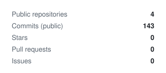
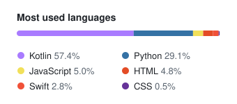
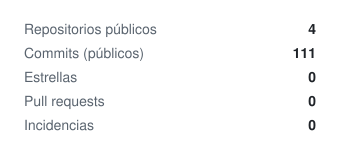
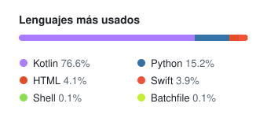

<b>English</b>

 

<h2 align="center">Hi, I'm AnxoBT 👋</h2>

Android and cross-platform apps · Automation 📍 Galicia, Spain

  
  
  
  
  
  

I build apps for Android, Windows and iPhone that respect your privacy: no tracking, no ads and no
servers of mine; your data only goes to the services you connect. I also write tools that automate
repetitive work.

#### 🛠️ What I work on

- Native Android apps with Kotlin, Jetpack Compose and Material 3, also on Windows with Compose Desktop
- Image processing on the device: smart fill, texture synthesis, filters and duplicate detection
- Python apps that run on the PC, Android and iPhone and keep your data in sync through public APIs
- Local-first design: data stays on your devices, with encrypted PC ↔ phone sync over Wi-Fi
- Release automation with GitHub Actions: signed builds for every platform and in-app update notices

#### 📌 Projects

<table>
  <tr>
    <td width="96" valign="top">
      
    </td>
    <td valign="top">
      <a href="https://github.com/AnxoBT/wallpaper-editor"><b>Wallpaper Editor</b></a>
       
      Fits any photo to your exact screen resolution, with a full editor (healing, layers, curves,
      filters). Turns your gallery into a live wallpaper that changes with a double tap, with a clock
      widget that matches each photo. 
      Android · Windows · iPhone (test) · <a href="https://github.com/AnxoBT/wallpaper-editor/releases/latest">Download</a> 
      Kotlin · Jetpack Compose · Compose Desktop · SwiftUI
    </td>
  </tr>
  <tr>
    <td width="96" valign="top">
      
    </td>
    <td valign="top">
      <a href="https://github.com/AnxoBT/tri-sync"><b>Tri-Sync</b></a>
       
      Keeps your watch history in sync between Letterboxd, Serializd, AniList and Dixmax, in any
      combination: review the differences, fix them in one click, explore your statistics and sync
      the PC and the phone over USB or Wi-Fi. 
      Windows · Android · iPhone (test) · <a href="https://github.com/AnxoBT/tri-sync/releases/latest">Download</a> 
      Python · Chaquopy · BeeWare
    </td>
  </tr>
  <tr>
    <td width="96" valign="top">
      
    </td>
    <td valign="top">
      <a href="https://github.com/AnxoBT/chronify"><b>Chronify</b></a>
       
      Sorts your Spotify playlists by the real release date of every song, checks that they agree with
      each other and shows statistics about your music; it syncs the PC and the phone over USB or Wi-Fi. 
      Windows · macOS · Linux · Android · Web · <a href="https://github.com/AnxoBT/chronify/releases/latest">Download</a> · <a href="https://anxobt.github.io/chronify/">Web app</a> 
      Python · Spotify API · MusicBrainz · Pyodide (PWA)
    </td>
  </tr>
</table>

All of them are open source (GPL-3.0), in English and Spanish, and tell you when a new version is out.

#### 📊 Stats

  <picture>
    <source media="(prefers-color-scheme: dark)" srcset="stats/stats-en-dark.svg">
    
  </picture>
  <picture>
    <source media="(prefers-color-scheme: dark)" srcset="stats/langs-en-dark.svg">
    
  </picture>

<b>Español</b>

 

<h2 align="center">Hola, soy AnxoBT 👋</h2>

Apps para Android y multiplataforma · Automatización 📍 Galicia, España

  
  
  
  
  
  

Hago apps para Android, Windows y iPhone que respetan tu privacidad: sin rastreo, sin anuncios y sin
servidores míos; tus datos solo van a los servicios que conectes. También escribo herramientas que
automatizan el trabajo repetitivo.

#### 🛠️ En qué trabajo

- Apps Android nativas con Kotlin, Jetpack Compose y Material 3, también en Windows con Compose Desktop
- Procesado de imagen en el dispositivo: relleno inteligente, síntesis de texturas, filtros y detección de repetidas
- Apps en Python que funcionan en el PC, Android y iPhone y mantienen tus datos sincronizados con API públicas
- Diseño local: tus datos se quedan en tus dispositivos, con sincronización PC ↔ móvil cifrada por Wi-Fi
- Publicación automatizada con GitHub Actions: versiones firmadas para cada plataforma y aviso de actualización en la app

#### 📌 Proyectos

<table>
  <tr>
    <td width="96" valign="top">
      
    </td>
    <td valign="top">
      <a href="https://github.com/AnxoBT/wallpaper-editor"><b>Wallpaper Editor</b></a>
       
      Adapta cualquier foto a la resolución exacta de tu pantalla, con un editor completo (corrector,
      capas, filtros, curvas). Convierte tu galería en un fondo dinámico que cambia con un doble
      toque, con un widget de reloj que se adapta a cada foto. 
      Android · Windows · iPhone (prueba) · <a href="https://github.com/AnxoBT/wallpaper-editor/releases/latest">Descargar</a> 
      Kotlin · Jetpack Compose · Compose Desktop · SwiftUI
    </td>
  </tr>
  <tr>
    <td width="96" valign="top">
      
    </td>
    <td valign="top">
      <a href="https://github.com/AnxoBT/tri-sync"><b>Tri-Sync</b></a>
       
      Mantiene tu historial sincronizado entre Letterboxd, Serializd, AniList y Dixmax, en cualquier
      combinación: revisa las diferencias, corrígelas con un clic, explora tus estadísticas y
      sincroniza el PC y el móvil por USB o Wi-Fi. 
      Windows · Android · iPhone (prueba) · <a href="https://github.com/AnxoBT/tri-sync/releases/latest">Descargar</a> 
      Python · Chaquopy · BeeWare
    </td>
  </tr>
  <tr>
    <td width="96" valign="top">
      
    </td>
    <td valign="top">
      <a href="https://github.com/AnxoBT/chronify"><b>Chronify</b></a>
       
      Ordena tus listas de Spotify por la fecha real de cada canción, comprueba que cuadran entre sí y
      muestra estadísticas de tu música; sincroniza el PC y el móvil por USB o Wi-Fi. 
      Windows · macOS · Linux · Android · Web · <a href="https://github.com/AnxoBT/chronify/releases/latest">Descargar</a> · <a href="https://anxobt.github.io/chronify/">App web</a> 
      Python · Spotify API · MusicBrainz · Pyodide (PWA)
    </td>
  </tr>
</table>

Todas son de código abierto (GPL-3.0), en inglés y español, y avisan cuando hay una versión nueva.

#### 📊 Estadísticas

  <picture>
    <source media="(prefers-color-scheme: dark)" srcset="stats/stats-es-dark.svg">
    
  </picture>
  <picture>
    <source media="(prefers-color-scheme: dark)" srcset="stats/langs-es-dark.svg">
    
  </picture>

